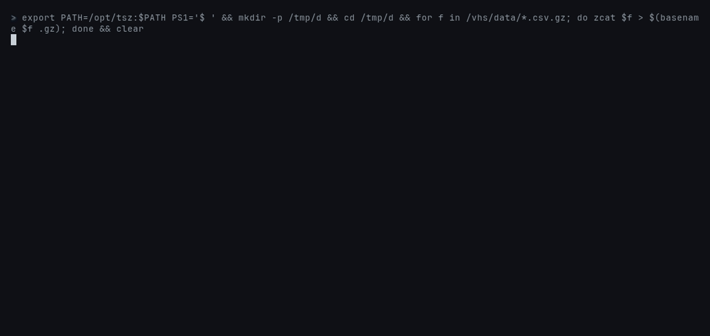

# tsz

[](https://github.com/ahmed-hashim-pro/tsz/actions/workflows/ci.yml) [](LICENSE)

Lossless compression for time series of `(i64 timestamp, f64 value)`, in
Rust with no dependencies. It implements Gorilla, Chimp and Chimp128, plus a
decimal codec for values that were printed as text. The `auto` mode picks
the smallest of these for each block of 4,096 points.

Gorilla, the compression behind Facebook's in-memory time-series database,
is the usual starting point. It XORs each value with the one before and
stores only the bits that changed. That works when neighbouring floats share
most of their bits. Most metrics, though, reach a database as text: a tide
gauge reports `1.327`, a power meter `2.580`. Parsed to a double, `1.327` is
a repeating binary fraction, and the XOR of two neighbouring readings is
mostly noise. On five of the six real series below, **Gorilla is bigger than
gzip of the CSV text**.

The decimal codec checks, bit for bit, whether every value in a block is
exactly `n / 10^d` for some small `d`. If so, it stores the integers `n` with
a variable-length code fitted to that block. Every encoding is lossless, and
every f64 bit pattern round-trips, NaN payloads included.

```
$ tsz compare data/*.csv
file                          points     gorilla     chimp  chimp128      auto   bits/point; auto's value codecs
noaa-sf-air-temp.csv          87,637       34.10     32.85     14.29      4.36   decimal 22
noaa-sf-water-level.csv       73,661       62.47     53.83     34.16      8.35   decimal 18
noaa-sf-wind-speed.csv        87,637       62.03     49.42     21.31      7.65   decimal 22
uci-power-active-2007.csv    521,669       52.05     44.23     27.53      9.18   decimal 128
uci-power-voltage-2007.csv   521,669       52.43     49.14     22.33     10.63   decimal 128
wikipedia-hourly-views.csv     8,784       28.34     32.77     39.77     23.72   decimal 3
```

Bits per point covers the timestamp and the value together; uncompressed is
128. The same series against other crates and general-purpose compressors:


**pco is smaller on every dataset**, by 11–26%, and decodes faster. More on
that [below](#against-other-crates).



## Quickstart

You need Rust 1.74 or newer.

```bash
git clone https://github.com/ahmed-hashim-pro/tsz.git && cd tsz
cargo build --release
export PATH=$PWD/target/release:$PATH

gunzip -k data/*.csv.gz          # six real series; data/README.md says where from
tsz compare data/*.csv           # the table above
tsz encode data/uci-power-active-2007.csv -o power.tsz
tsz inspect power.tsz            # blocks, codecs, bits per point
tsz decode power.tsz | head -3
tsz verify data/*.csv            # every codec, round-tripped bit for bit

cargo test                       # 21 tests, about 10 s from cold
```

`tsz encode` reads one `timestamp,value` per line, from a file or `-` for
stdin. Timestamps are integers in any unit. Values are anything Rust's f64
parser accepts (`1.5`, `-0`, `NaN`, `inf`), or `0x` followed by 16 hex
digits for an exact bit pattern. `tsz decode --bits` prints that form back,
so NaN payloads survive the trip through text.

As a library (not on crates.io; see [below](#what-this-does-not-do)):

```toml
[dependencies]
tsz-codec = { git = "https://github.com/ahmed-hashim-pro/tsz" }
```

```rust
use tsz_codec::{decode, encode, Encoder, Options};

let bytes = encode(&timestamps, &values, Options::default());
let series = decode(&bytes)?; // series.timestamps, series.values

// Or one point at a time; each full block is compressed as it fills.
let mut e = Encoder::new(Options::default());
e.push(1_700_000_000, 1.327);
let bytes = e.finish();
```

## Against other crates

`make bench` (or `cd bench && cargo run --release`) runs every method on
every dataset. It checks that each one round-trips bit for bit, then times
it. Speeds are the median of 9 runs on one core of an Intel i5-12400F, in
Docker, with other work on the machine, so treat them as ±15%. Sizes are
deterministic, and CI checks that the chart matches the code.

Bits per point, lower is better:

| dataset | points | csv.gz | zstd | tsz crate | pco | gorilla | chimp | chimp128 | tsz auto |
|---|--:|--:|--:|--:|--:|--:|--:|--:|--:|
| noaa-sf-air-temp | 87,637 | 28.80 | 22.78 | 34.66 | **3.61** | 34.10 | 32.85 | 14.29 | 4.36 |
| noaa-sf-water-level | 73,661 | 37.39 | 30.74 | 65.85 | **6.43** | 62.47 | 53.83 | 34.16 | 8.35 |
| noaa-sf-wind-speed | 87,637 | 31.34 | 27.00 | 62.09 | **6.16** | 62.03 | 49.42 | 21.31 | 7.65 |
| uci-power-active-2007 | 521,669 | 33.39 | 22.80 | 52.54 | **6.75** | 52.05 | 44.23 | 27.53 | 9.18 |
| uci-power-voltage-2007 | 521,669 | 36.35 | 26.85 | 52.51 | **8.56** | 52.43 | 49.14 | 22.33 | 10.63 |
| wikipedia-hourly-views | 8,784 | 56.22 | 47.76 | 28.33 | **21.22** | 28.34 | 32.77 | 39.77 | 23.72 |

Millions of points per second, encode / decode:

| dataset | zstd | tsz crate | pco | gorilla | chimp | chimp128 | tsz auto |
|---|--:|--:|--:|--:|--:|--:|--:|
| noaa-sf-air-temp | 24 / 47 | 34 / 66 | 27 / 108 | 115 / 115 | 86 / 89 | 102 / 108 | 27 / 83 |
| noaa-sf-water-level | 21 / 51 | 34 / 74 | 22 / 109 | 129 / 105 | 76 / 92 | 54 / 69 | 26 / 91 |
| noaa-sf-wind-speed | 23 / 46 | 23 / 53 | 27 / 108 | 131 / 97 | 80 / 73 | 66 / 81 | 26 / 89 |
| uci-power-active-2007 | 23 / 47 | 22 / 56 | 22 / 113 | 123 / 96 | 75 / 84 | 65 / 81 | 25 / 81 |
| uci-power-voltage-2007 | 21 / 47 | 29 / 74 | 21 / 112 | 136 / 127 | 67 / 91 | 59 / 85 | 25 / 89 |
| wikipedia-hourly-views | 18 / 37 | 46 / 100 | 7 / 153 | 159 / 145 | 92 / 95 | 76 / 80 | 21 / 103 |

The methods:

- **csv.gz** is the data file itself: gzip -9 of the text.
- **zstd** is level 3 on the raw columns (all timestamps, then all values).
- **tsz crate** is [`tsz`](https://crates.io/crates/tsz) 0.1.4, an existing
  implementation of Gorilla as the paper describes it.
- **pco** is [pcodec](https://crates.io/crates/pco) 1.0.4 at its default
  level, with timestamps and values as separate chunks.

What the numbers say:

- **pco wins on size everywhere**, by 11–26%, and decodes 1.2–1.5x faster.
  Like this crate's decimal codec, it notices that the floats are multiples
  of a decimal step. It then goes further, with entropy coding over bins
  fitted to the whole chunk. If you can hand data over in chunks, use pco.
- **`auto` encodes at about pco's speed** (21–27 M points/s against 7–27).
  On the five sensor series it is 5–8x smaller than Gorilla and 2.5–5x
  smaller than zstd. On the Wikipedia counts it is only 16% smaller than
  Gorilla, and 12% bigger than pco.
- **This crate's Gorilla is within 2% of the `tsz` crate's size** on five
  datasets, which is some evidence that both follow the paper. On the water
  level, which has gaps, it is 5% smaller. It encodes 3.5–5.7x faster and
  decodes 1.4–1.8x faster.
- **Gorilla loses to gzip of the CSV on five of six series.** Chimp helps a
  little. Chimp128 helps more, because sensors revisit the same readings and
  an exact repeat within 128 points costs 9 bits.
- **Gorilla beats both Chimps on the Wikipedia counts.** They are integers
  stored as floats, so their XORs have long runs of trailing zeros. Chimp
  pays 11 bits of header for every such XOR, where Gorilla usually reuses
  its previous window for 2.

## How it works

### Format

```text
"TSZ" 0x01
block*    varint points (1..=1048576)
          u8     timestamp codec << 4 | value codec
          varint timestamp bytes, then the timestamp bit stream
          varint value bytes, then the value bit stream
0x00      end of stream; nothing may follow
```

Blocks are independent: each starts from a raw 64-bit first timestamp and
value. Timestamps and values are separate bit streams, so each block can
choose their codecs separately. The format is pinned by a test that hashes
the bytes every codec writes for a fixed series.

### Gorilla (timestamps and values)

Timestamps store the delta of the delta, zigzag-encoded, in buckets: a `0`
bit for "same interval as last time" (one bit per point on a regular
scrape), then 7, 9, 12 or 32 bits. Two changes from the paper, so that
*every* i64 sequence round-trips:
- A fifth bucket carries a full 64 bits, for jumps, timestamps that go
  backwards, and `i64::MIN` next to `i64::MAX`. All arithmetic wraps.
- The first delta goes through the same buckets instead of a fixed 14 bits.

Values follow the paper exactly:
- `0` when the XOR with the previous value is zero.
- `10` plus the meaningful bits, when they fit the previous window.
- `11` plus 5 bits of leading zeros, 6 bits of length, then the bits.

### Chimp and Chimp128

[Chimp](https://www.vldb.org/pvldb/vol15/p3058-liakos.pdf) observes that
XORs of real values rarely have many trailing zeros. It only stores a
trailing-zero count when there are more than six, and rounds the
leading-zero count to one of eight values so that it fits in three bits.

Chimp128 also lets each value pick its reference from the previous 128. It
looks up one that shares the value's low 14 bits, through a table from those
bits to where they were last seen. Both follow the paper's flag layout.

### The decimal codec

For `d` from 0 to 15, the encoder tries `n = round(v × 10^d)` on every value
in the block, and keeps the first `d` for which `n / 10^d` is *the same
bits* as `v`, with `|n| <= 2^53`. Division and parsing are both correctly
rounded, so `1327 / 1000` is exactly the double that `"1.327"` parses to.
Comparing bits rather than values is what keeps it lossless:
- `-0.0` and NaN never match, so a block containing one falls back to a
  float codec.
- A value that was computed rather than printed (`0.1 + 0.2`) doesn't match
  either.

The integers then go to an adaptive integer code (`src/intcode.rs`). Each
residual is the first or the second difference, zigzagged, whichever order
the block prefers. Each residual is written as:

```text
0                   residual is 0
10  + w1 bits       fits in w1 bits
110 + w2 bits       fits in w2 bits
111 + 6 + len bits  anything else: its length, then its bits
```

The encoder picks `w1` and `w2` for each block from a histogram of residual
lengths, trying all 2,016 pairs, which costs almost nothing. The same coder
competes for the timestamps.

### `auto`: measure, then write

Every encoder is generic over a bit sink. `auto` first runs each candidate
into a counter that only adds up lengths, and only writes the cheapest. The
counter gives up as soon as it passes the best size so far. Decimal is tried
first, because when it applies it usually wins by a wide margin, so the
float codecs usually stop well before the end of the block. That took
`auto` from about 17 to about 26 M points/s on encode, and it is still
guaranteed to be no bigger than any fixed codec on any input. The property
tests check that guarantee.

Exact repeats are where Chimp128 beats the decimal codec. A sine wave
rounded to two places has only about 200 distinct values, and Chimp128 codes
each repeat in 9 bits. `auto` picks Chimp128 there.

## Commands

```
tsz encode  <in.csv|-> [-o out.tsz] [--codec C] [--block N]   compress, print the size breakdown
tsz decode  <in.tsz> [-o out.csv] [--bits]                     back to timestamp,value lines
tsz inspect <in.tsz>                                           blocks, codecs, bits per point
tsz compare <in.csv>... [--block N]                            bits per point under every codec
tsz verify  <in.csv>... [--block N]                            round-trip every codec, bit for bit
```

`--codec` is `gorilla`, `chimp`, `chimp128` or `auto` (the default). Exit
codes are 0 ok, 1 when `verify` finds a mismatch, and 2 for bad input or
usage. Bad input names its line: `power.csv:3: value "four" is not a number`.

## How it is tested

- **Round trips.** Seeded generators build adversarial series and check
  every codec, bit for bit:
  - every NaN class with random payloads, both zeros and both infinities;
  - subnormals and the extremes;
  - printed decimals with the odd special value dropped in;
  - repeated palettes, and counters stored as floats;
  - timestamps that are regular, jittered, backwards, duplicated, random,
    or `i64::MIN`/`MAX`;
  - lengths of 0, 1, 2 and block ±1, and block sizes from 1 up.

  `cargo test` runs 20,000 series. `make soak` and CI run a million (about
  70 s), and both also check that `auto` is never bigger than a fixed codec.
- **Untrusted input.** Every truncation of a valid stream must be an error.
  Flipped bits, and random bytes after a valid header, must never panic. A
  header that claims a huge block is refused before anything is allocated.
- **Fuzzing.** Two cargo-fuzz targets:
  - `decode`: arbitrary bytes, with and without the magic in front.
  - `roundtrip`: an arbitrary series under arbitrary options.

  A 15-minute run of each, 107 million and 2.3 million executions, found
  nothing. CI runs each for two minutes on every push.
- **The papers' bit costs.** A constant series costs exactly 1, 2 and 9
  bits per value under Gorilla, Chimp and Chimp128, and a regular clock 1
  bit per timestamp.
- **The CLI**, as a user runs it: exact bits through text with `--bits`,
  stdin and stdout, errors that name the line, and `decode | head` dying
  quietly instead of panicking.
- **Do the tests catch bugs?** While building this, I planted nine bugs by
  hand, one at a time. These included comparing decimal values instead of
  bits, a 63-bit top timestamp bucket, a Chimp128 table not reset between
  blocks, an off-by-one escape length, and ties going to the wrong candidate.
  Eight made the suite fail. The ninth loosened Chimp128's candidate check,
  which turned out to be redundant: a candidate shares the low 14 bits, so
  its XOR always has more than 13 trailing zeros. Changing it can't change
  any output.

## What this does not do

- **It isn't on crates.io.** `tsz` there is the older Gorilla crate this one
  is compared with. The package here is called `tsz-codec`, and the binary
  `tsz`.
- **pco compresses these datasets better.** See the tables. `auto` is a
  good, simple, dependency-free second.
- **No exceptions in the decimal codec.** One value in a block that isn't
  `n / 10^d` sends the whole block to a float codec. ALP and pco handle
  outliers individually; this doesn't.
- **No checksums.** A corrupt stream fails to decode only if the corruption
  breaks its structure. A flipped bit inside a payload can decode to wrong
  values, without an error. Wrap it in something with a CRC if that matters.
- **No index.** Blocks are independent, but finding the block for a time
  range means walking the framing from the start.
- **One series of `(i64, f64)`.** No integer or string values, no multiple
  columns, no tags.
- **No lossy modes.** Nothing rounds, quantizes or drops points.
- **Speeds are from one machine**, on six datasets. Run `make bench` on
  yours.

## Layout

```
src/
  lib.rs        format, Encoder, decode, auto's choice
  bits.rs       bit writer, counting sink, buffered bit reader
  gorilla.rs    delta-of-delta timestamps, XOR values
  chimp.rs      Chimp and Chimp128
  decimal.rs    printed-decimal detection and codec
  intcode.rs    adaptive integer code (timestamps, decimal integers)
  main.rs       the CLI
tests/          round trips, corrupt input, the CLI
fuzz/           cargo-fuzz targets (nightly)
bench/          the comparison against zstd, tsz, pco; its own package
data/           six real series and their sources (data/README.md)
scripts/        fetch_data.py rebuilds data/ from the sources
docs/           bench.svg, bench.json, demo.gif (make bench, make demo)
```

## License

MIT. The files in `data/` keep their own licences; see `data/README.md`.
